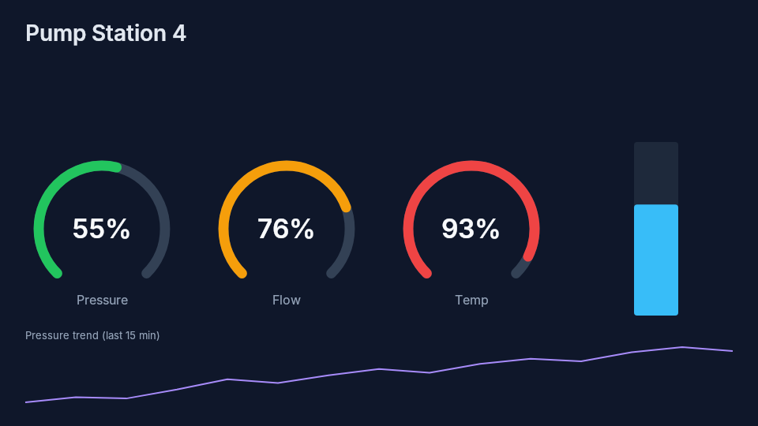
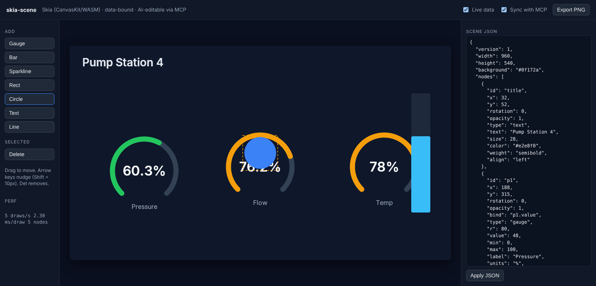

# skia-scene

**Live, data-bound dashboards described as JSON and rendered with Skia, in the browser and on the server, and buildable by an AI agent through MCP.**



One small JSON scene format, three ways to use it:

| Part | Tech | What it does |
|---|---|---|
| `packages/core` | TypeScript, Zod, CanvasKit | Scene schema and validation, data binding, threshold (alarm) colors, grid layout, and a Skia renderer |
| `apps/web` | Vite, CanvasKit (Skia → WebAssembly + WebGL) | Editor: drag to move, add widgets, edit JSON, live simulated data, export PNG |
| `apps/mcp-server` | Model Context Protocol SDK | Lets Claude, Copilot or any MCP client **build the dashboard from plain English** and see a rendered PNG of its own work |
| `server-dotnet` | ASP.NET Core 8, **SkiaSharp** | Stateless render API: `POST /render` returns a PNG; cached, rate-limited, Docker-ready |



## Why this is interesting

- **Same engine everywhere.** CanvasKit (browser and Node) and SkiaSharp (.NET) are both Skia, so the editor preview, the AI's preview and the server export draw the same picture from the same JSON.
- **The scene is the only state.** Every frame is drawn from the JSON, so undo, sync, caching and AI edits stay simple and predictable.
- **Data binding built in.** Any node can `bind` to a data key (`"pump1.pressure"`). Gauges, bars and shapes recolor by `thresholds`, text fills in `{value}`, and sparklines keep a rolling window.
- **AI that checks its own work.** The MCP `render_png` tool returns an image, so the agent can look at the layout and fix overlaps itself.

## Quick start

```bash
npm install
npm run dev            # editor on http://localhost:5173
npm test               # core unit tests
npm run smoke -w @skia-scene/mcp-server -- out.png   # drives the MCP tools end to end, writes a PNG
```

### Let an AI build a dashboard

Add the server to your MCP client (Claude Desktop, VS Code Copilot agent mode, etc.). See `examples/mcp-config.json`:

```json
{ "mcpServers": { "skia-scene": { "command": "npx", "args": ["tsx", "/path/to/skia-scene/apps/mcp-server/src/index.ts"] } } }
```

Keep `npm run dev` running, then ask: *"Build a pump station dashboard with pressure, flow and temperature gauges, alarm at 70 and 90, and a tank level bar."* The editor polls `public/scene.json`, so you watch the agent build it live.

**Tools:** `new_scene`, `get_scene`, `add_node`, `update_node`, `remove_node`, `layout_grid`, `render_png`.

### SkiaSharp render API (.NET 8)

```bash
cd server-dotnet/SkiaScene.Server
dotnet run --urls http://localhost:8080
curl -X POST localhost:8080/render -H 'content-type: application/json' \
     --data @../../examples/pump-station.json -o scene.png
# preview alarm colors with live values:
curl -X POST 'localhost:8080/render?data={"p1.value":95}' --data @../../examples/pump-station.json -o alarm.png
```

## Scene format

```json
{
  "width": 960, "height": 540, "background": "#0f172a",
  "nodes": [
    { "id": "p1", "type": "gauge", "x": 200, "y": 260, "r": 80, "value": 48, "label": "Pressure", "units": "%",
      "bind": "p1.value", "thresholds": [{ "at": 70, "color": "#f59e0b" }, { "at": 90, "color": "#ef4444" }] }
  ]
}
```

Node types: `rect`, `circle`, `line`, `text`, `gauge`, `bar`, `sparkline`. All share `id`, `x`, `y`, `rotation`, `opacity` and `bind`. See [`packages/core/src/schema.ts`](packages/core/src/schema.ts).

## Built to scale

- **Stateless render service.** No session state, so you can run N copies behind a load balancer (`docker compose up --scale render=3`).
- **Content-hash cache.** Identical scene + data → SHA-256 key → cached PNG (size-bounded LRU). Repeat renders cost nothing. Swap the in-memory cache for Redis to share it across instances.
- **Back-pressure.** A per-instance concurrency limiter with a bounded queue returns `429` instead of falling over under load.
- **Bounded inputs.** Max 2 MB body and 4096 × 4096 canvas, and the schema is validated before any drawing.
- **WASM memory safety.** Every CanvasKit `Paint`/`Path`/`Surface` is freed after use, and fonts are cached per size, so long sessions don't leak.
- **Redraw on change only.** The editor redraws when the scene or data changes, not every frame, and shows draws/s and ms/draw.
- **CI.** GitHub Actions typechecks, tests and smoke-renders the TS side, then builds the .NET API and renders the sample scene through it.

## Roadmap

- WebSocket / SSE data source in place of the simulator
- Undo/redo via JSON patches
- Redis cache and OpenTelemetry traces for the render API

## License

MIT. Inter font under the SIL Open Font License.
